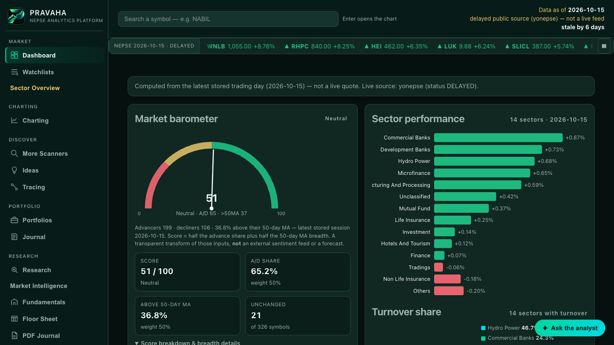
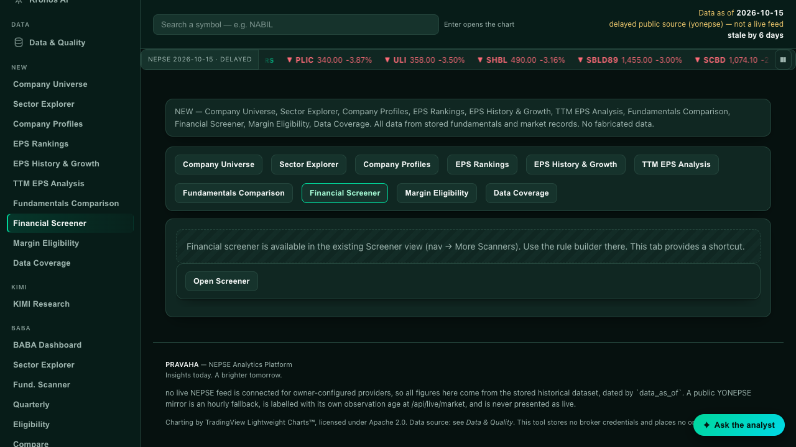
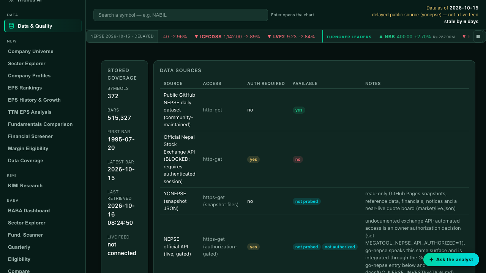
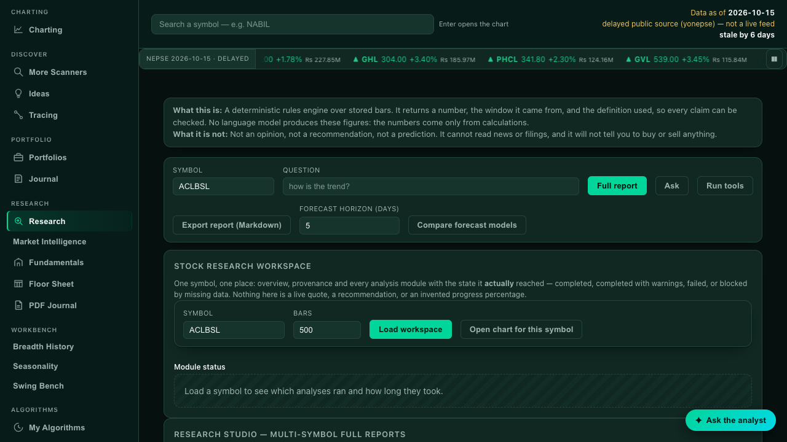
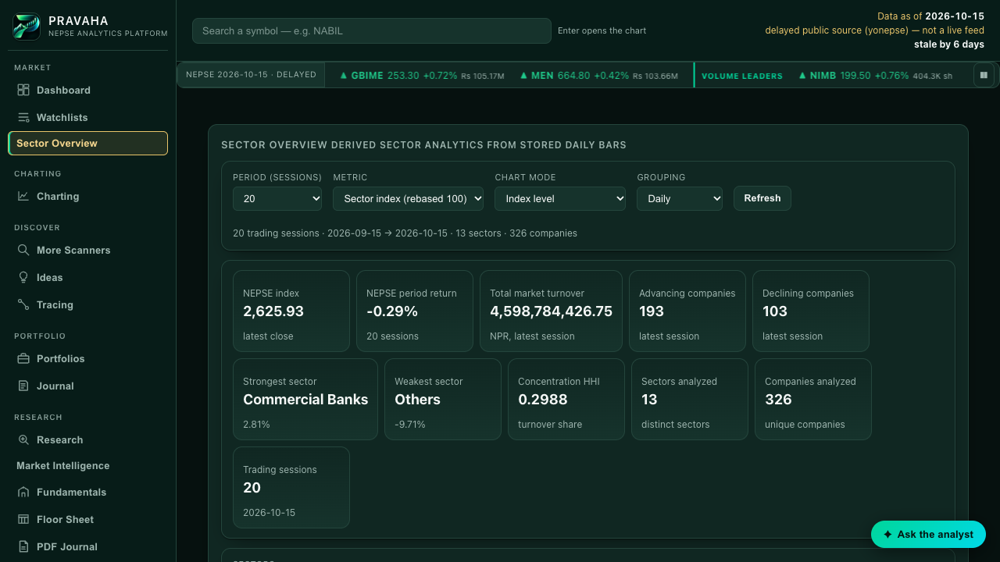

# PRAVAHA — NEPSE Analytics Platform

Local NEPSE quantitative research, technical analysis, and trading-analytics terminal.

> **Personal research software.** Mega Tool does not place trades, does not store broker
> or Mero Share credentials, and does not provide investment advice. Backtests and model
> forecasts describe historical or experimental results only and are **not** evidence of
> future performance. Verify all data independently before making financial decisions.

## Status

See `PROJECT_STATUS.md` for the verified feature matrix and `SESSION_HANDOFF.md` for
the current state and next task.

## Quick start

```bash
cd "Downloads/AI trading NEPSE"
uv sync                      # install dependencies into ./.venv
uv run megatool init         # create the local databases
uv run megatool fetch        # download real NEPSE history (network)
uv run megatool serve        # start the web terminal at http://127.0.0.1:8710
```

Run the test suite:

```bash
uv run pytest                # ≈3,200 tests, ~2.5 min
```

Stop the server with `Ctrl-C`.

## What it does

| Area | What you get |
| --- | --- |
| **Data** | 514,018 real daily bars across 372 symbols (1995 → 2026-10-09), every row carrying its source and retrieval time. Rows flagged `invalid` are excluded from every calculation, and `suspect` rows are kept and disclosed. **Two gaps are known and not yet fixed:** all 115 rows whose `high < low` are excluded (that part is sound), but 40,446 bars whose `open` or `close` falls outside `[low, high]` and 10 bars carrying a zero price are still read as-is — they are flagged, not dropped. See B-20/B-21 in `KNOWN_BUGS.md` |
| **Charting** | Candles, volume and 28 indicators, aligned to price by trading date; swing points and market structure (HH/HL/LH/LL, breaks) drawn as markers |
| **Research workspace** | One card in the existing Research tab composes overview, swing structure, Fibonacci retracements/extensions, support–resistance zones, candlestick detections, the research report and data quality into a single dated payload — each module reporting its own real state and elapsed time, one failing without hiding the others. The synchronous card shows no completion percentage, because none is measurable; the background **Research Studio** below does, because it counts finished steps |
| **Research Studio** | Select one or many symbols and exactly which analyses a report contains, or choose **Full research report** (80 public components across fundamentals, quarterly statements, valuation, eligibility, sector, technicals, dividends, risk, charts and data quality). Builds run as background jobs with a persisted job id, real step-based progress, stage, failure reason and resumable downloads: combined PDF, XLSX (native Excel charts), JSON, and a ZIP with per-symbol PDFs/XLSX and one CSV per component. Journal and portfolio components are stripped for every non-owner request |
| **Range forecasting** | Next-session **high-low range** (not direction): a naive baseline plus EWMA true range, HAR and a blend, scored by expanding-origin one-step-ahead walk-forward on stored bars. Reports MAE, RMSE, median APE, improvement vs naive and the measured 80% interval coverage. A constant-rupee risk budget turns a forecast into share sizing at 0.5×–2× the expected range; no order is created |
| **Report Builder** | 200 selectable components in 16 categories. Only selected, available components are computed and rendered; an unselected section is absent from every format. Components with no data stay visible as unavailable with their real reason and are never filled with estimates. XLSX, one-CSV-per-section ZIP, PDF and JSON, plus save/load/rename/delete templates |
| **Scheduled public data** | A Cloudflare Worker cron (`*/10`) re-reads the public YONEPSE JSON, validates it, keeps the last good snapshot on failure, distinguishes publisher timestamp from retrieval time, and never turns an LTP snapshot into OHLCV. It also pings Render's public health route so the free instance does not cold-start. The Data tab shows the edge's last check, last success, failures and freshness |
| **Scanner** | 19 metrics, 4 presets, composable AND/OR filter trees |
| **Backtesting** | Own long/flat engine: next-bar-open fills, fees and slippage, a buy-and-hold benchmark, and every assumption printed with the result |
| **Research assistant** | A deterministic rules engine that answers *descriptive* questions with the window and definition behind every number, and refuses to predict or recommend |
| **Forecasting** | Six transparent models, each scored on an unseen hold-out against the naive "last value" baseline, with a plain-words verdict |
| **Portfolio** | Positions derived from your own transaction ledger, valued at the latest stored close |
| **Journal & planning** | Trade journal with win rate, R multiples and plan adherence; a planner that turns entry/stop/target into a position size for a risk budget |
| **Floor sheet** | Import a session's CSV (`megatool floor import`, the **Floor Sheet** web tab, or the API) and see buyer/seller concentration and counterparties, described as broker codes rather than as people. `megatool floor summary` prints the analysis with its limits |
| **Ranking** | `POST /api/rank` and a panel in the Screener tab: weighted, percentile-ranked factors where **every score decomposes into per-factor contributions that add back to it**. Missing data is substituted with the cross-sectional median *and flagged*; symbols without enough history are listed separately with a reason. Factors needing data this tool does not have (P/E, P/B, dividend yield, index- and sector-relative rank) are named and held at zero weight rather than faked |
| **Walk-forward validation** | `POST /api/walk-forward`, `megatool walk-forward`, and `scripts/walk_forward_report.py`: rank at each period end using only data available then, hold the top and bottom quantiles, and measure the forward return against the universe benchmark and a random-selection baseline. **On the real store the ranking's top quartile underperformed its bottom quartile in every window tested — and no alternative factor weighting passed validation either.** The result is reported with its caveats, not hidden. Full analysis: `docs/RANKING_VALIDATION_REPORT.md` |
| **Fundamentals** | An 11th tab plus `POST /api/fundamentals/import`: CSV in, every value carrying its source, reporting period, unit and verification level. P/E, P/B and dividend yield **refuse** unreviewed inputs, unknown periods, periods too far apart, stale figures and non-positive denominators. Nothing is fetched from the web |
| **Written PDF** | The 52-page handwritten journal is inventoried and cross-validated. Automated OCR cannot read it, so records are transcribed visually with per-value confidence, and review happens in three places (API, PDF Journal tab, `megatool pdf review`). Settlement and total arithmetic self-checks catch transcription errors |

## What it deliberately does not do

- **No live trading, ever.** No broker integration, no order routing, no credentials.
- **No live market feed.** The official NEPSE API requires an authenticated session
  (HTTP 401 on all probed endpoints), so every price shown is a stored end-of-day close
  and the UI says so.
- **No predictions.** Forecasting output is labelled with its assumptions, and a model
  that cannot beat "use yesterday's close" is reported as having demonstrated no skill.
- **No scraping.** Competitor sites publish pages, not APIs; floor-sheet and fundamentals
  analysis are import-based instead.
- **No synthetic data in real datasets.** Test fixtures are written to throwaway paths
  and are labelled `SYNTHETIC-TEST-FIXTURE`.

## Screenshot gallery

See [`docs/SCREENSHOT_GALLERY.md`](docs/SCREENSHOT_GALLERY.md) for the full gallery. Sample views:







## Layout

| Path | Purpose |
| --- | --- |
| `megatool/` | Application package (data layer, indicators, scanner, backtest, forecast, research, portfolio, journal, planning, floor sheet, API) |
| `web/static/` | Web terminal front end (no build step required) |
| `scripts/` | Maintenance / data-collection helpers |
| `tests/` | Automated tests (pytest) |
| `docs/` | Architecture, data sources, decisions, research register, screenshots |
| `data/` | Local databases and downloads (git-ignored) |

## Data provenance

Every stored price bar carries a `source` label and a `retrieved_at` timestamp. Records
originating from test fixtures are labelled `SYNTHETIC-TEST-FIXTURE` and are never mixed
into real datasets. Imported floor sheets record the file's source label and a content
hash, so re-importing the same file cannot double-count a session. See
`docs/DATA_SOURCES.md`.
