# PRAVAHA — Screenshot Gallery

Fifteen screenshots of the real PRAVAHA application, captured on 2026-10-21
from the running development instance (`http://127.0.0.1:10000`) at a
1440 × 1000 desktop viewport (the responsive shot uses a 768 px width).
All images show the actual application interface. Market data shown is the
application's stored NEPSE end-of-day data (public market data). No
portfolio, journal, written-PDF, or personal-account views are included, to
avoid exposing private information. No credentials or tokens are visible.

## Dashboard

### 01 — Main Dashboard
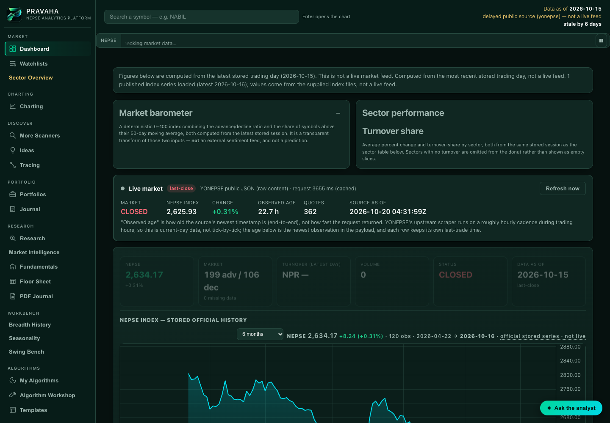

The primary PRAVAHA interface: top navigation, dashboard cards, market
snapshot, breadth, and the main visual hierarchy.

### 02 — Market Overview
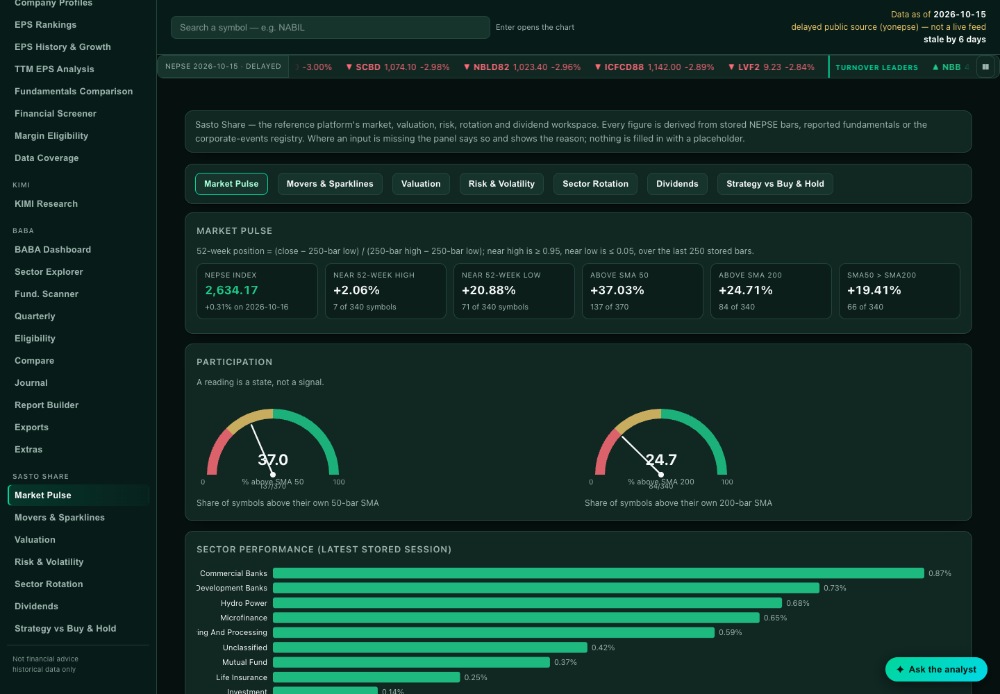

Market Pulse view with index information, market summary, and relevant
market statistics.

### 14 — Data Quality and Transparency
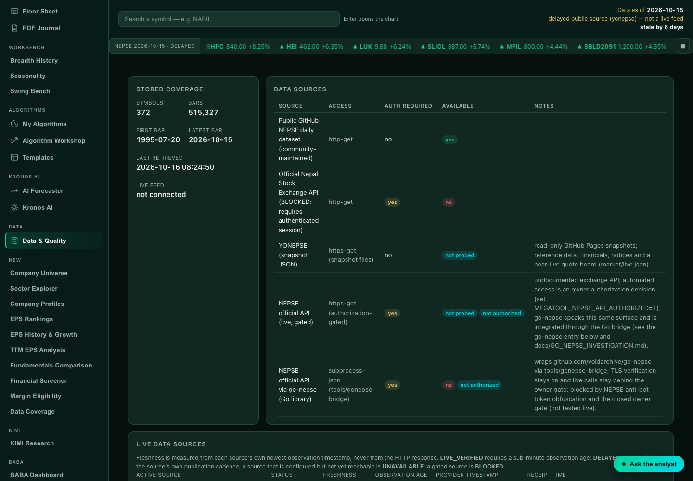

Data freshness, source information, validation status, and quality
disclosures for the stored NEPSE dataset.

## Market Analytics

### 07 — Turnover Analysis
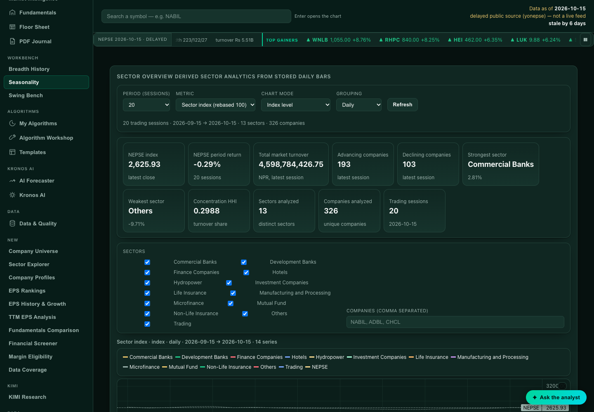

Turnover analysis with correctly labelled NPR units and readable
large-number formatting (from the Sector Overview turnover sections).

### 08 — Sector Turnover Comparison
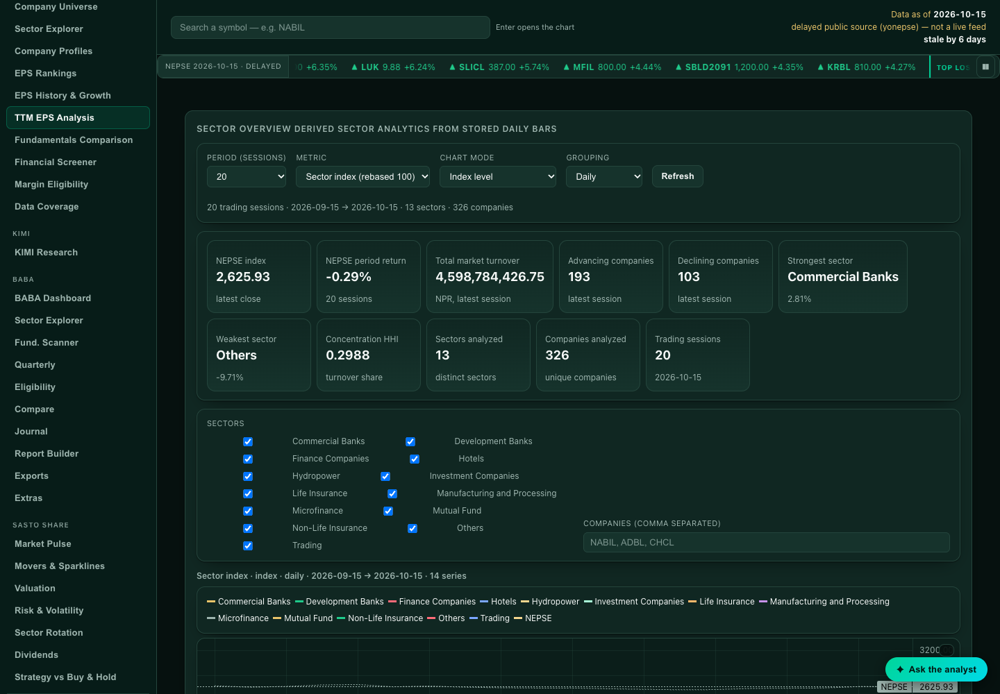

Sector-level turnover comparisons with market-total information, derived
from stored session data (not synthetic).

## Sector Analysis

### 03 — Sector Overview
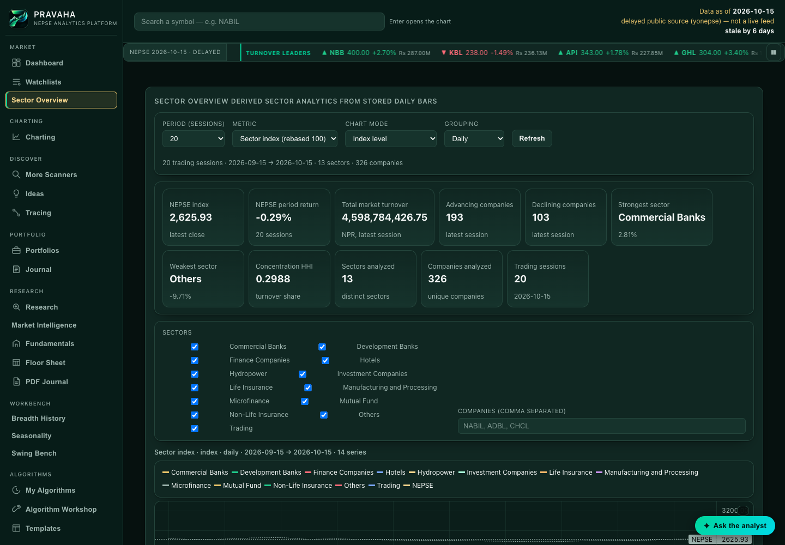

Full Sector Overview interface: controls, sector table, and main
visualizations.

### 04 — Sector Index Analysis
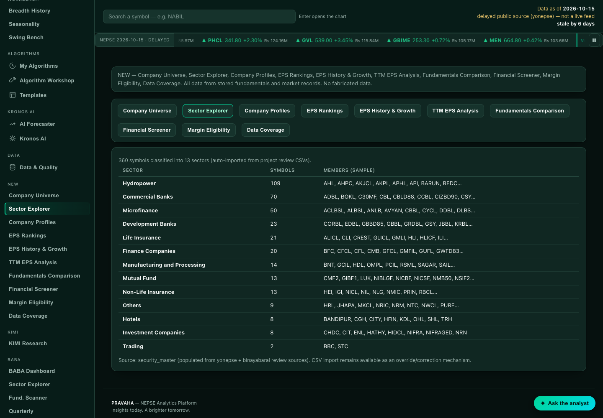

Sector index chart with metric, date range, axis labels, and legend
visible.

### 05 — Sector Performance Comparison
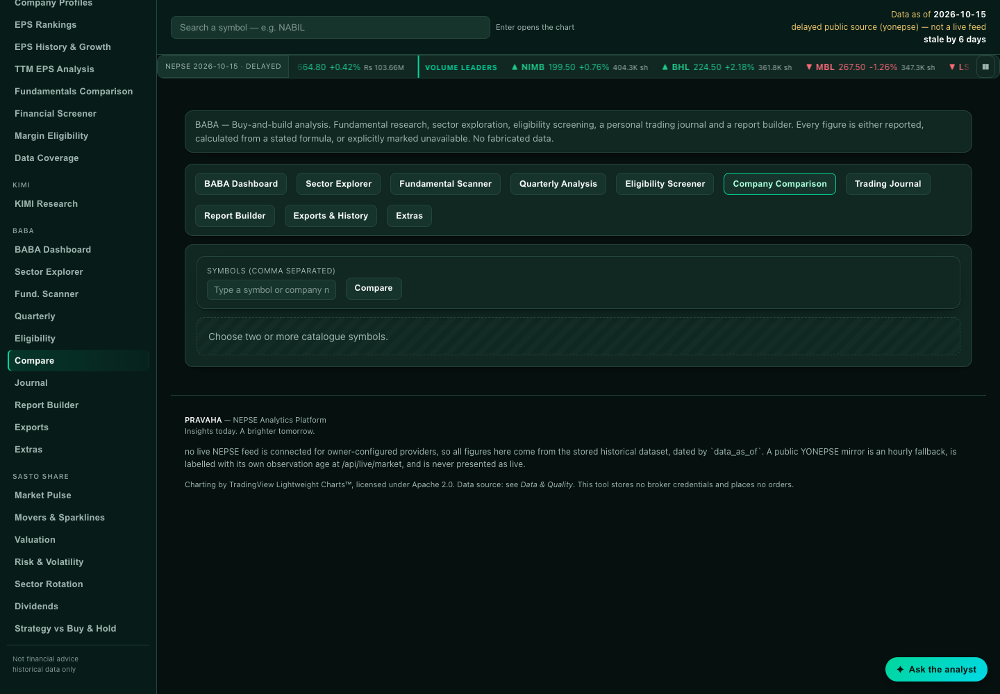

Multiple sector series compared with readable axes and comparison
controls.

### 06 — Daily Sector Performance Matrix
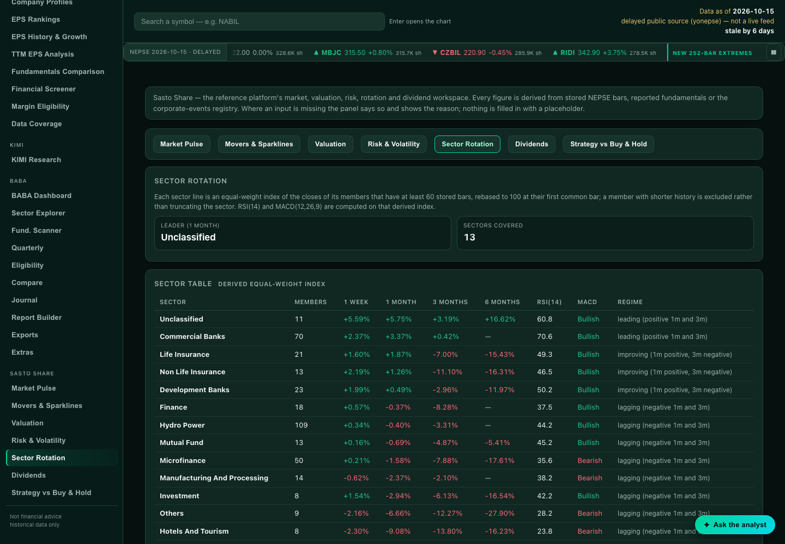

Sector-by-date percentage-change matrix with actual dates, percentage
values, and period controls (implemented feature).

## Trading Tools

### 10 — Interactive Charting
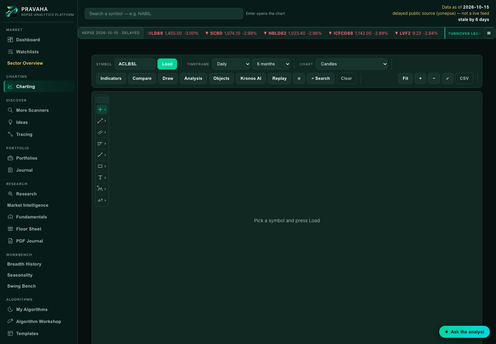

Main charting interface with readable axes, visible chart, and relevant
controls.

### 11 — Drawing Tools
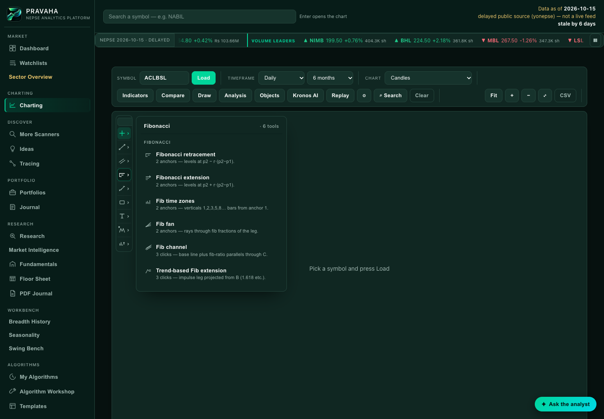

Available chart drawing tools and an example of an opened tool menu.

### 12 — Technical Analysis
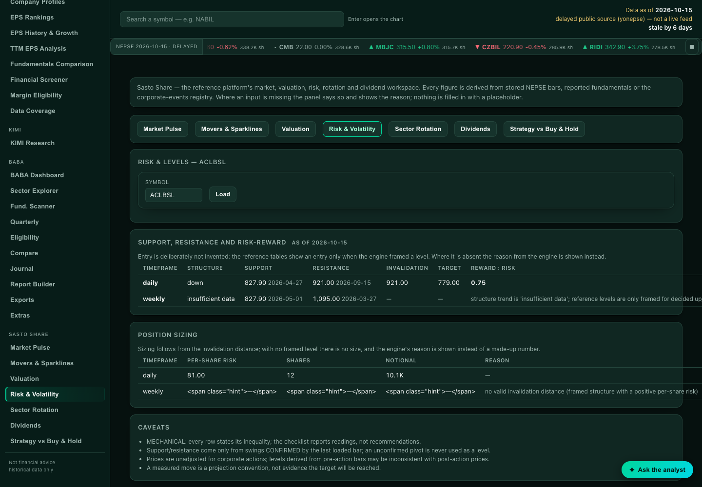

Existing technical analysis / risk-and-volatility panel. Only implemented
indicators and panels are shown.

## Search and Filtering

### 13 — Search and Filtering
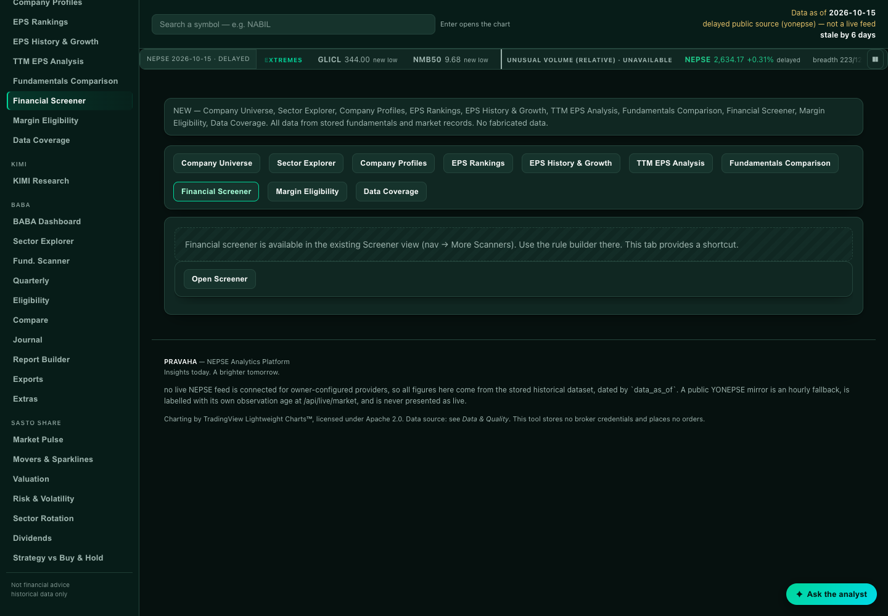

Real search interface with available filtering and sorting controls
(Financial Screener).

## Company Analysis

### 09 — Company Analysis
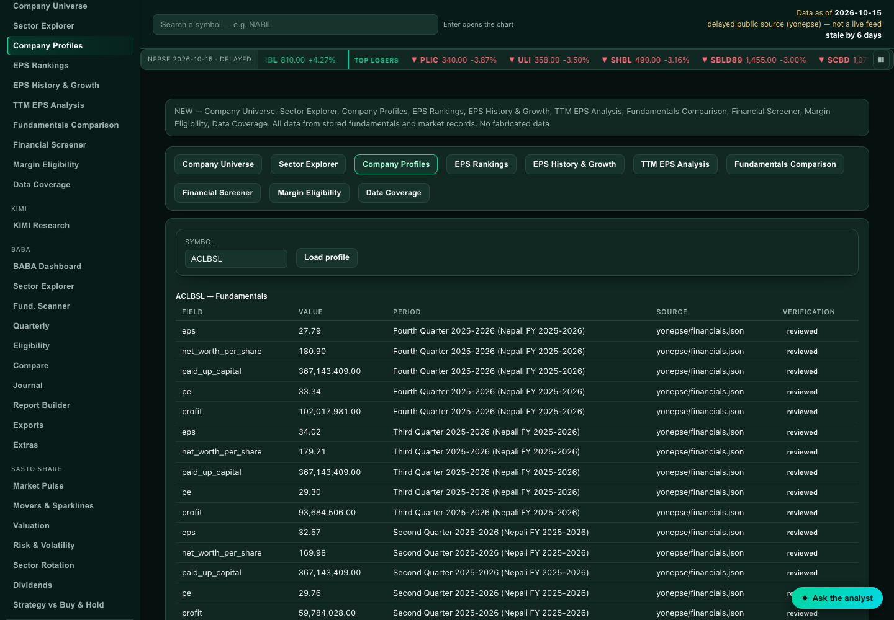

Existing company analysis screen with its available metrics and charts.

## Interface

### 15 — Responsive Interface
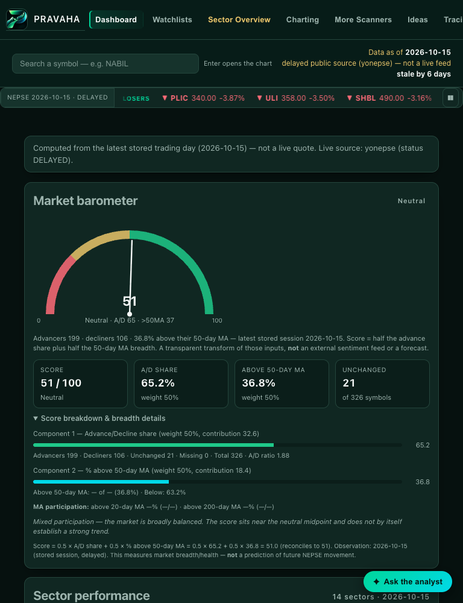

Narrower-screen (768 px) layout using the application's actual responsive
interface — not a shrunk desktop screenshot.
